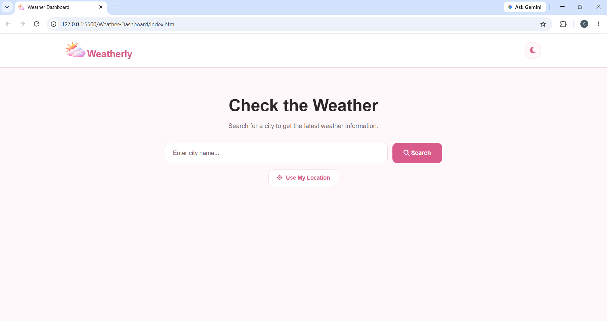
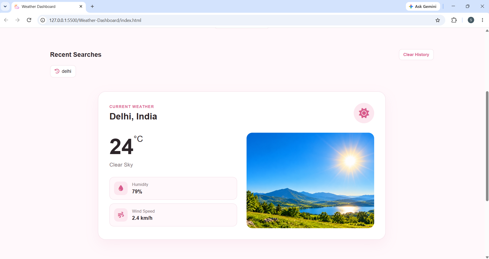
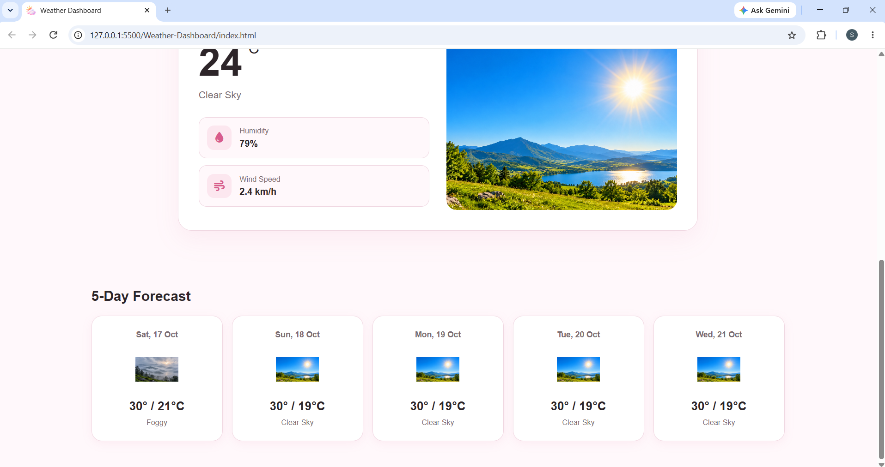
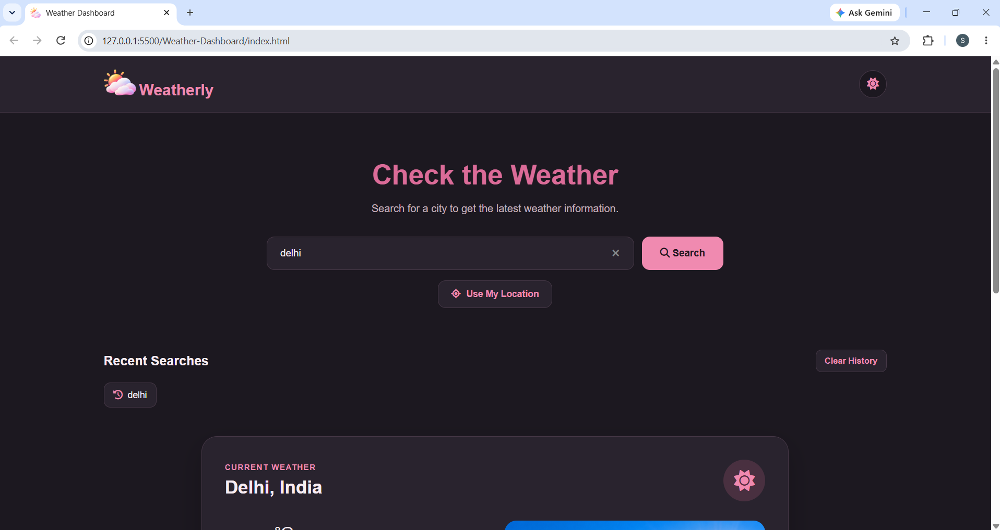

# Weather Information Dashboard

## Project Overview
The Weather Information Dashboard is a responsive web application that allows users to search for a city and view its current weather information and a 5-day weather forecast.

## Features
- Search weather by city name
- Display temperature and weather conditions
- Show humidity and wind speed
- Weather icons and images
- Loading indicator and error handling
- 5-day weather forecast
- Current location weather
- Dark mode
- Recent searches
- Responsive design for desktop, tablet, and mobile devices

## Technologies Used
- HTML5
- CSS3
- JavaScript
- Open-Meteo Weather API
- Open-Meteo Geocoding API
- Font Awesome

## Project Structure
```text
Weather-Dashboard/
├── images/
├── screenshots/
│   ├── dashboard.png
│   ├── weather-result.png
│   ├── forecast.png
│   └── dark-mode.png
├── index.html
├── style.css
├── script.js
└── README.md
```

## How to Run the Project
1. Download or clone this repository.
2. Open the project folder.
3. Open `index.html` in your browser.
4. Search for a city to view its weather information.

## Live Demo
[View Live Website](https://weather-information-dashboard.vercel.app/)

## GitHub Repository
[View Source Code](https://github.com/RajputShraddha27/weather-information-dashboard)

## Screenshots

### Weather Dashboard


### Weather Information


### 5-Day Forecast


### Dark Mode


## Project Purpose
This project was developed as a beginner-level internship mini project to practice HTML, CSS, JavaScript, API integration, and responsive web design.

## Author
Rajput Shraddha